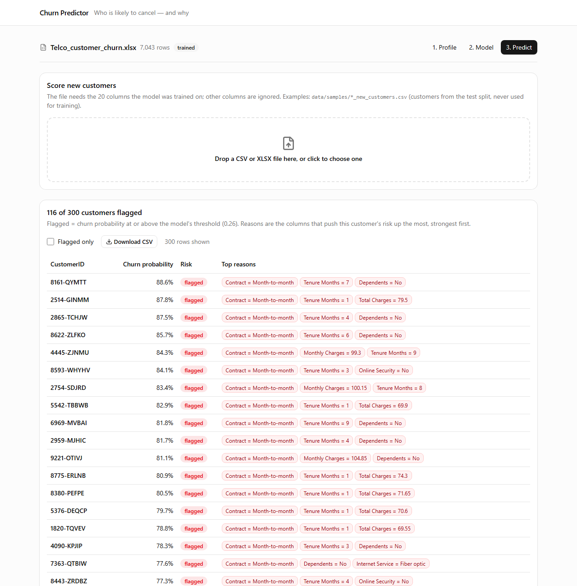
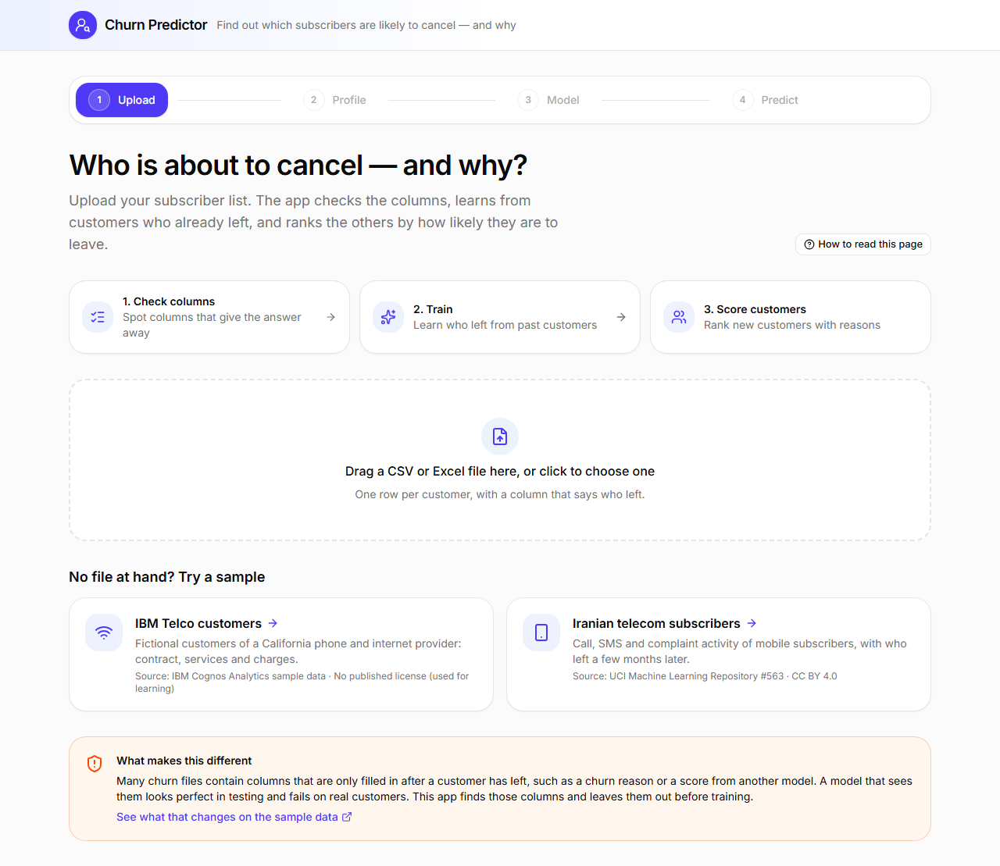
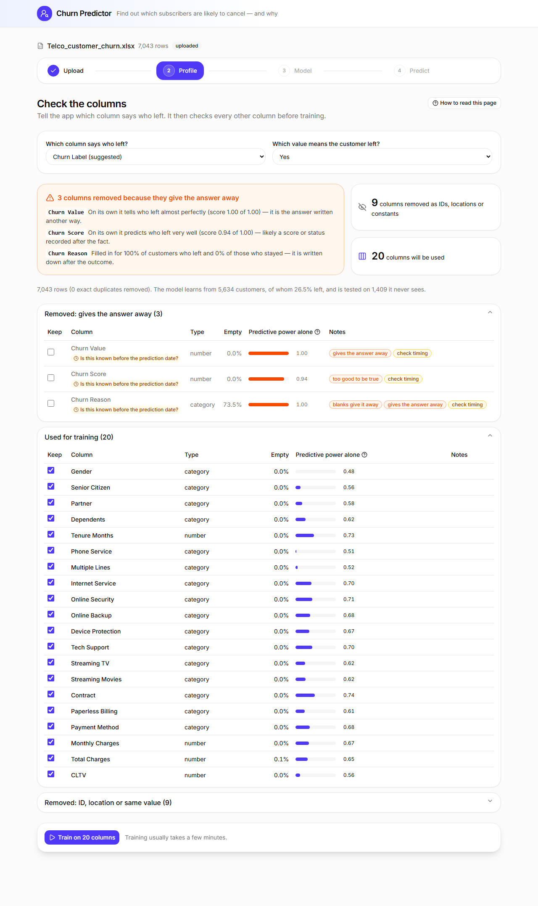
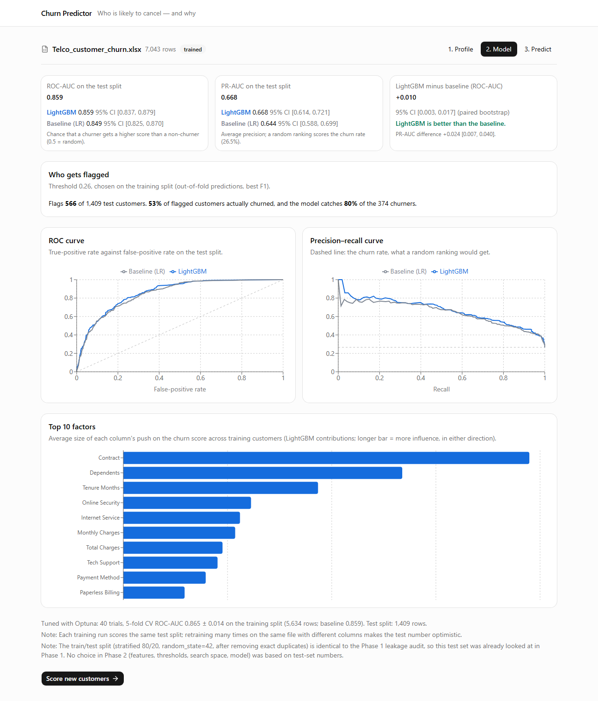

# Churn Predictor

Upload a list of telecom subscribers and find out who is likely to cancel — and why.



<!-- Demo GIF goes here: docs/images/demo.gif -->

## Problem → Approach → Results

<!-- summary:start -->
- **Problem.** The original AutoML pipeline reported ROC-AUC **0.999** on IBM Telco. Three columns leak the answer (`Churn Reason`, `Churn Score`, `Churn Label`), and SMOTE ran before cross-validation.
- **Approach.** Profile every column on the training split only and flag leaks by single-column AUC and missingness; keep all learned steps in one scikit-learn `Pipeline`; tune one LightGBM with Optuna by CV on train; compare it with a logistic-regression baseline on a test split scored once, with bootstrap CIs.
- **Results.** IBM Telco: LightGBM **0.859** [0.837, 0.879] vs LR 0.849 [0.825, 0.870], a small edge of +0.010 [0.003, 0.017]. UCI Iranian: LightGBM **0.988** vs LR 0.927.
- Sources: `reports/legacy_repro_telco.json`, `reports/leakage_audit_telco.json`, `reports/metrics_telco.json`, `reports/metrics_iranian.json`.
<!-- summary:end -->

## Results

<!-- results:start -->
**1. Removing leakage on IBM Telco** (fixed LightGBM unless noted; *reported* is what the old protocol would show, CV AUC from the drop rows on).

| Step | Reported AUC | Test ROC-AUC |
|---|---:|---:|
| Legacy pipeline as shipped (its own code, 10 Optuna trials) | 0.999 | 0.993 |
| Same protocol, fixed LightGBM (all leaks, SMOTE before CV) | 1.000 | 1.000 |
| Drop `Churn Reason` | 0.982 | 0.980 |
| Drop `Churn Score` and `CLTV`, SMOTE still in the CV pipeline | 0.849 | 0.841 |
| Clean features, SMOTE **before** CV (for comparison) | 0.928 | 0.841 |
| No SMOTE, `class_weight='balanced'` | 0.848 | 0.841 |

Generated by `scripts/audit/legacy_repro.py` (first row) and `python -m scripts.audit.leakage_audit --dataset telco` (other rows; full ladder in `docs/cleanup/leakage_audit.md`). The audit also dropped `CLTV`; the final profiler keeps it because it is not flagged (see Limitations).

**2. Clean results on the held-out test split** (95% bootstrap CIs, 1,000 paired resamples).

| Dataset (test rows, churn rate) | Model | ROC-AUC | PR-AUC | Threshold | Precision / recall |
|---|---|---|---|---:|---|
| IBM Telco (1,409, 27%) | LightGBM (Optuna) | 0.859 [0.837, 0.879] | 0.668 [0.614, 0.721] | 0.26 | 53% / 80% |
| | Logistic regression | 0.849 [0.825, 0.870] | 0.644 [0.588, 0.699] | | |
| | Difference (paired) | +0.010 [0.003, 0.017] | +0.024 [0.007, 0.040] | | |
| UCI Iranian (570, 16%) | LightGBM (Optuna) | 0.988 [0.978, 0.995] | 0.951 [0.920, 0.978] | 0.23 | 81% / 92% |
| | Logistic regression | 0.927 [0.899, 0.949] | 0.760 [0.677, 0.831] | | |
| | Difference (paired) | +0.061 [0.041, 0.088] | +0.191 [0.131, 0.259] | | |

Generated by `python -m src.churn.evaluate --dataset telco|iranian` (`reports/metrics_*.json`). The threshold maximises F1 on out-of-fold training predictions; precision/recall are for LightGBM on the test split.
<!-- results:end -->

## How it works

```
CSV/XLSX → profile (train split, leakage flags) → LightGBM + Optuna in one Pipeline vs LR baseline → test once → reasons via pred_contrib
```

1. **Upload** a file (or try a bundled sample). Rows that are exact duplicates are removed, then the data is split 80/20 (stratified, seed 42).
2. **Profile.** Each column gets a role (id, constant, numeric, categorical, datetime) and flags, all measured on the training split: *target copy* / *likely leakage* (a model on that column alone is too good), *missing reveals target*, *location*, and a *check timing* question for names like `score` or `reason`. Flagged columns are unticked by default.
3. **Train.** One LightGBM, tuned by Optuna on 5-fold CV of the training split, and a logistic-regression baseline. Every learned step is inside the `Pipeline`, so the saved model scores raw uploaded columns. No resampling or calibration, so the probabilities shown are the model's own.
4. **Evaluate once** on the test split, with paired bootstrap CIs for both models and their difference.
5. **Predict.** Each customer gets a probability, a flag at the F1 threshold chosen on training data, and up to three reasons from LightGBM's `pred_contrib` (labelled strong / moderate / slight).

| Upload | Profile | Model |
|---|---|---|
|  |  |  |

**Stack:** pandas + scikit-learn · LightGBM + Optuna · MLflow (local `./mlruns`) · FastAPI + SQLite · Next.js (Tailwind, shadcn/ui, TanStack Query, Recharts) · GitHub Actions

**Data:** [IBM Telco Customer Churn](data/raw/README.md) (IBM Cognos Analytics sample, no published license) and [UCI Iranian Churn](data/raw/iranian_churn/SOURCE.md) (CC BY 4.0). `data/samples/*_new_customers.csv` are customers from the **test split** (never used for training), for trying the Predict page.

## How to run

Python 3.11 and Node 22. Run every command from the repo root.

```bash
# 1. Set up once: virtual environment and dependencies
python -m venv .venv
source .venv/bin/activate                # Windows: .venv\Scripts\activate
pip install -r requirements.txt
npm --prefix frontend ci

# 2. Terminal 1: API on http://localhost:8000 (keep it running)
python -m uvicorn src.api.main:app --port 8000

# 3. Terminal 2: web app on http://localhost:3000
npm --prefix frontend run dev

# Optional: re-create reports/metrics_telco.json
python -m src.churn.evaluate --dataset telco
```

Activate `.venv` in every terminal that runs Python. Settings are in `.env.example`. Tests: `pip install -r requirements-dev.txt`, then `python -m pytest -q`.

## Limitations

<!-- limitations:start -->
- **The Telco test split was seen before.** Phase 1 of the cleanup scored the same split (same seed); no Phase 2 choice used test numbers, but the split is not pristine.
- **IBM Telco is fictional sample data** from IBM Cognos Analytics with no published license; it is used for learning only.
- **`CLTV` is kept** because the profiler does not flag it (single-column AUC 0.56), but it is a value IBM computed, not a raw attribute.
- **UCI Iranian is thinly documented**: 300 exact duplicate rows (removed), and 14 groups of rows with identical features but different labels. Its very high AUC has no single leaking column (`docs/cleanup/leakage_audit.md`).
- **The profiler only catches statistical leakage.** It cannot know when a column was recorded (for example the call `duration` in UCI Bank Marketing is only known after the call); the timing question in the UI is a prompt, not a check.
- **The F1 threshold flags many customers**: 566 of 1,409 Telco test customers (40%). A retention team with a fixed budget would pick its own cut-off.
- **Tuning hit an edge of the search space** on Telco (`min_child_samples` = 198, range 20–200), so a wider range might change the model slightly.
- **Not done:** the Cell2Cell dataset; one user, no authentication, no deployment.
<!-- limitations:end -->

## Authors

Phan Thanh Tấn. The cleanup history of this repository (inventory of the old code, leakage audit) is in [`docs/cleanup/`](docs/cleanup/).
